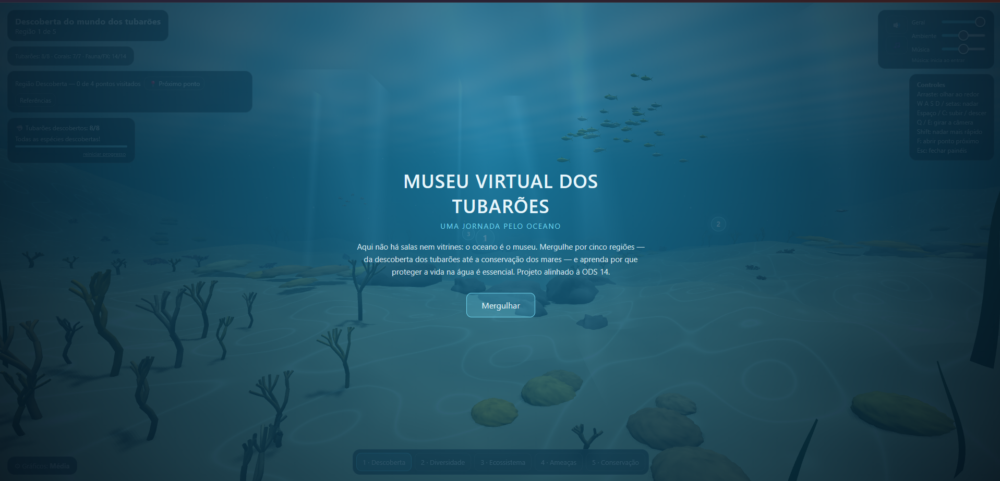
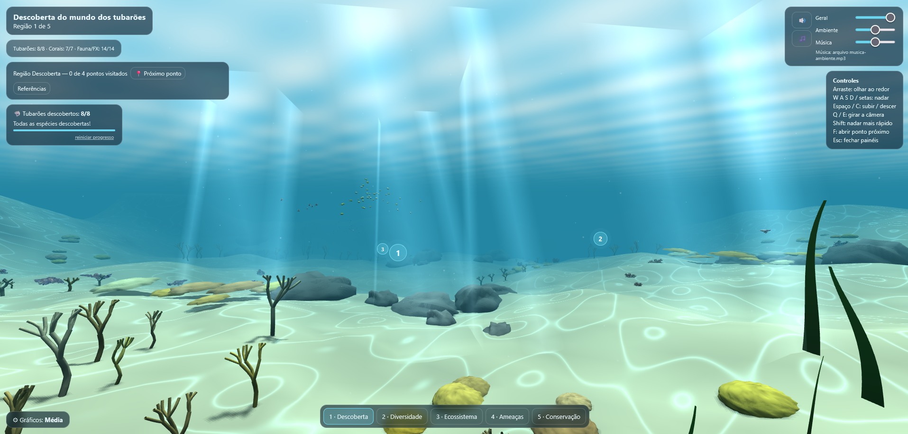
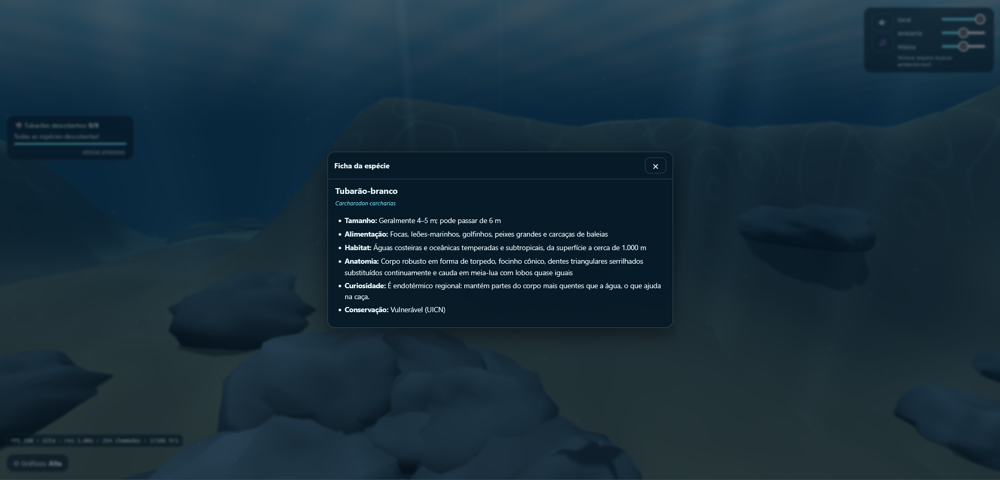
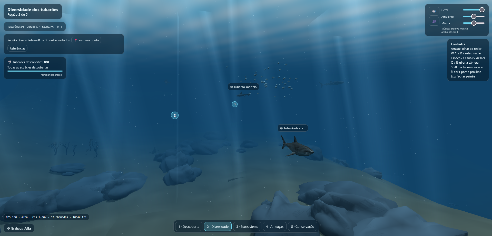
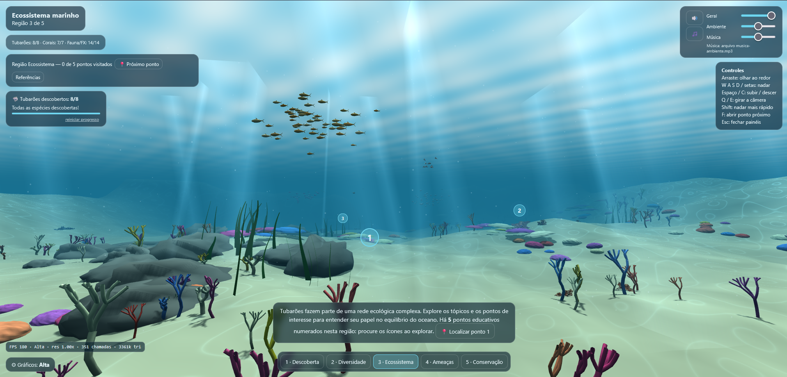
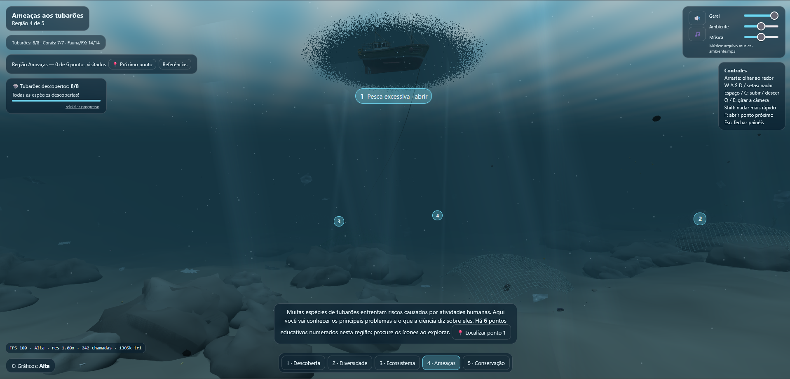
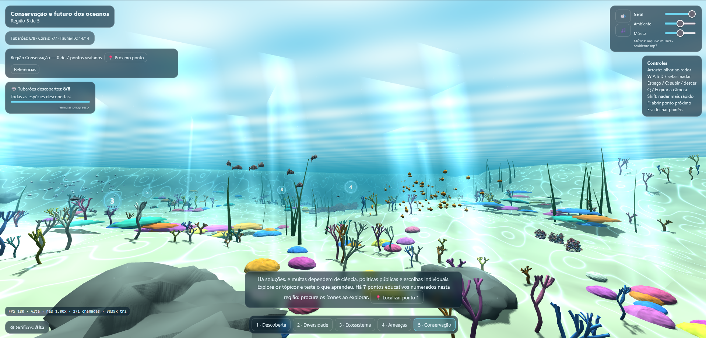
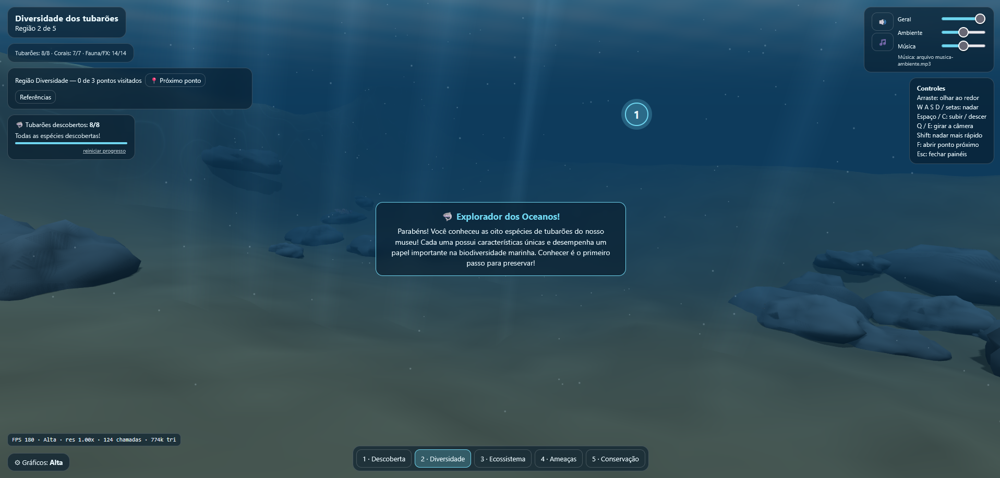

# :coral: Museu Virtual dos Tubarões

*Uma experiência interativa de exploração, conhecimento e conservação dos oceanos.*

O **Museu Virtual dos Tubarões** é uma experiência web em 3D em que o visitante **mergulha no oceano** para conhecer a diversidade dos tubarões, o equilíbrio dos
ecossistemas marinhos, as ameaças causadas pelas atividades humanas e as formas de proteger a vida na água. Não há salas nem vitrines: **o próprio oceano é o museu**.

> **Acesse online:** **https://stelariz.github.io/museu-virtual-tubaroes/**

---

## :compass: Sumário

- [Sobre o projeto](#-sobre-o-projeto)
- [Contexto acadêmico](#-contexto-acadêmico)
- [Objetivo de Desenvolvimento Sustentável](#-objetivo-de-desenvolvimento-sustentável)
- [Funcionalidades](#-funcionalidades)
- [Espécies disponíveis](#-espécies-disponíveis)
- [Regiões do museu](#-regiões-do-museu)
- [Tecnologias utilizadas](#-tecnologias-utilizadas)
- [Processo de desenvolvimento com inteligência artificial](#-processo-de-desenvolvimento-com-inteligência-artificial)
- [Como executar o projeto localmente](#-como-executar-o-projeto-localmente)
- [Como acessar o museu online](#-como-acessar-o-museu-online)
- [Estrutura de pastas](#-estrutura-de-pastas)
- [Créditos e atribuições](#-créditos-e-atribuições)
- [Licenças e direitos autorais](#-licenças-e-direitos-autorais)
- [Considerações finais](#-considerações-finais)


















---

## :ocean: Sobre o projeto

O museu foi concebido como um **documentário submarino interativo**. O visitante nada livremente por cinco regiões oceânicas contínuas, observa tubarões e outros animais
em seus habitats e descobre informações educativas distribuídas pelo próprio cenário, em pontos numerados.

- **Caráter educativo:** cada região tem pontos de interesse com explicações organizadas por tópico, fichas das espécies e, ao final, uma atividade opcional de perguntas e respostas.
- **Exploração tridimensional:** navegação em primeira pessoa, com luz, névoa e profundidade que mudam conforme a região.
- **Importância dos tubarões:** o museu mostra que muitas espécies são predadores de topo ou filtradores e que ajudam a manter equilibrados os ecossistemas marinhos.
- **Conscientização:** a região *Ameaças* mostra impactos da pesca excessiva e da poluição, e a região *Conservação* apresenta soluções e ações do dia a dia, ligadas à ODS 14.

## :mortar_board: Contexto acadêmico

| | |
| :-- | :-- |
| **Instituição** | FATEC São Carlos |
| **Curso** | Big Data para a Indústria |
| **Disciplina** | Gestão de Projetos |
| **Tipo** | Projeto acadêmico (sem fins comerciais) |
| **Autoria** | Stela Maris Rizzi, Kevyn Aparecido de Oliveira Bispo |
| **Professor(a) responsável** | Gilvane Aparecida de Carvalho |
| **Ano/semestre** | Nov/2026 |

## :earth_americas: Objetivo de Desenvolvimento Sustentável

O projeto se relaciona com a **ODS 14 — Vida na Água**, um dos 17 Objetivos de Desenvolvimento Sustentável da Organização das Nações Unidas (Agenda 2030), que busca
**conservar e usar de forma sustentável os oceanos, os mares e os recursos marinhos**. O museu aborda esse objetivo ao tratar de redução da poluição marinha, proteção de
ecossistemas e espécies, pesca sustentável, áreas marinhas protegidas e ações individuais de conservação. Mais informações: [ONU — ODS 14](https://sdgs.un.org/goals/goal14).

## :sparkles: Funcionalidades

Todas as funcionalidades abaixo foram confirmadas no código da versão final.

- **Ambiente submarino em 3D** com relevo, luz solar atravessando a água, névoa, partículas em suspensão e cáusticas.
- **Cinco regiões temáticas** contínuas, com atalho pelo menu inferior.
- **Oito espécies de tubarões** em modelos 3D, que nadam pelo cenário; clique no tubarão (ou no botão **ⓘ**) para abrir a **ficha da espécie** (nome científico, tamanho, alimentação, habitat, anatomia, curiosidade e estado de conservação).
- **Contador de tubarões descobertos** (n/8) com barra de progresso, salvo no navegador, botão para reiniciar o progresso e mensagem de conclusão ao descobrir as oito espécies.
- **25 pontos de interesse educativos numerados** distribuídos pelas regiões, com painel centralizado, indicação de pontos visitados, botão “Próximo ponto” e botão **Referências**; a região Conservação inclui um quiz de 3 perguntas com explicação das respostas.
- **Outros animais marinhos** animados: tartarugas (cabeçuda e de-pente), polvos, chocos, caranguejos, lesma-do-mar (nudibrânquio), cavalos-marinhos e cardumes de peixes.
- **Região Ameaças** com redes de pesca abandonadas, barril, plásticos flutuando e animais convivendo com a poluição.
- **Som ambiente submarino** gerado no navegador (Web Audio) e **trilha musical** instrumental, com controles de volume geral, ambiente e música, botão de música e botão de silenciar.
- **Configurações gráficas** *Alta / Média / Baixa* (com detecção automática conservadora da placa de vídeo), contador opcional de FPS e otimizações para computadores com GPU integrada.
- **Controles de navegação:** arrastar o mouse para olhar; `W A S D` ou setas para nadar; `Espaço` / `C` para subir e descer; `Q` / `E` para girar a câmera; `Shift` para nadar mais rápido; `F` para abrir o ponto próximo; `Esc` para fechar painéis.

> **Observação sobre dispositivos móveis:** o museu não foi otimizado nem testado em celulares. Existe apenas um botão “avançar” para telas de toque.


## :shark: Espécies disponíveis

| # | Grupo | Espécie | Nome científico |
| :-: | :-- | :-- | :-- |
| 1 | Mais conhecidas | Tubarão-branco | *Carcharodon carcharias* |
| 2 | Mais conhecidas | Tubarão-martelo (martelo-gigante) | *Sphyrna mokarran* |
| 3 | Mais conhecidas | Tubarão-baleia | *Rhincodon typus* |
| 4 | Mais conhecidas | Tubarão-tigre | *Galeocerdo cuvier* |
| 5 | Exóticas e menos conhecidas | Tubarão-anjo (anjo-do-atlântico) | *Squatina dumeril* |
| 6 | Exóticas e menos conhecidas | Tubarão-duende | *Mitsukurina owstoni* |
| 7 | Exóticas e menos conhecidas | Tubarão-peregrino | *Cetorhinus maximus* |
| 8 | Exóticas e menos conhecidas | Tubarão-boca-grande | *Megachasma pelagios* |

Os nomes científicos seguem as fichas do próprio museu; confira-os em fontes como a [IUCN Red List](https://www.iucnredlist.org/) antes de usar em trabalhos formais.
**Sobre a escala:** por limitações de capacidade computacional, os modelos não estão em escala real entre si nem em relação ao visitante; têm finalidade ilustrativa e educativa.

## :world_map: Regiões do museu

| # | Região | Objetivo educativo | Pontos de interesse |
| :-: | :-- | :-- | :-: |
| 1 | **Descoberta** | Introdução: o que são os tubarões, evolução, sentidos e mitos e verdades | 4 |
| 2 | **Diversidade** | Apresentação das oito espécies, em habitats de águas abertas, fundo arenoso e zona profunda; escolha das espécies e escala dos modelos | 3 |
| 3 | **Ecossistema** | Teias alimentares, equilíbrio ecológico, habitats, recifes de coral e biodiversidade | 5 |
| 4 | **Ameaças** | Pesca excessiva, captura acidental, comércio de barbatanas, poluição, mudanças climáticas e destruição de habitats | 6 |
| 5 | **Conservação** | Proteção dos tubarões, áreas marinhas protegidas, pesca sustentável, recifes, ODS 14, ações individuais e quiz | 7 |

## :hammer_and_wrench: Tecnologias utilizadas

Somente tecnologias confirmadas no código do projeto:

| Tecnologia | Uso |
| :-- | :-- |
| **HTML5** | Estrutura da página e da interface |
| **CSS3** | Estilo da interface (painéis translúcidos, menus, responsividade) |
| **JavaScript** (sem framework) | Lógica do museu, interações, animações, áudio e interface |
| **[Three.js](https://threejs.org/) r128** | Renderização 3D, carregamento de modelos (GLTFLoader) e animações (AnimationMixer) |
| **WebGL** | Renderização acelerada por GPU, via Three.js |
| **glTF / GLB 2.0** | Formato dos modelos 3D |
| **Web Audio API** | Som ambiente submarino e trilha de reserva gerada no navegador |
| **localStorage** | Guarda a qualidade gráfica escolhida e o progresso de tubarões descobertos |

Não há servidor, banco de dados, cadastro ou bibliotecas externas carregadas pela internet: tudo é servido a partir dos arquivos do repositório.

## :robot: Processo de desenvolvimento com inteligência artificial

O museu é resultado da **combinação de diferentes ferramentas de inteligência artificial e de recursos de terceiros**, orquestrados pelos autores ao longo de várias etapas. Nenhuma ferramenta criou o projeto sozinha.

| Ferramenta | Papel no projeto |
| :-- | :-- |
| **ChatGPT** | Apoio ao **planejamento e à engenharia de prompts**: desenvolver e organizar a ideia inicial, estruturar os requisitos, planejar as regiões temáticas e a experiência educativa, elaborar prompts detalhados, definir funcionalidades e melhorias, organizar solicitações de correção e auxiliar na resolução de problemas. |
| **Claude** | **Desenvolvimento e implementação**: geração, estruturação e modificação do código; ambiente 3D; integração dos modelos; navegação; painéis educativos; interações com os tubarões; ajustes de interface; correções e otimizações de desempenho; sistemas de áudio e demais funcionalidades. |
| **Suno AI** | Geração, com auxílio de IA, da **trilha sonora** instrumental, calma e imersiva, criada para complementar a exploração submarina. |
| **Sketchfab** | Origem dos **modelos 3D**, disponibilizados gratuitamente pelos seus criadores, que mantêm os direitos autorais (veja [`CREDITOS.md`](CREDITOS.md)). |

**Um processo iterativo.** O desenvolvimento ocorreu em sucessivas versões: a cada etapa os autores definiam um objetivo, o ChatGPT ajudava a transformá-lo em um prompt claro, o Claude
implementava ou ajustava o código, e os autores testavam o resultado no navegador, identificavam problemas (por exemplo, orientação de animais, sobreposição de elementos da interface,
desempenho em notebook) e refinavam os prompts para a etapa seguinte. Além dos testes dos autores, houve verificações automatizadas em navegador sem interface, que **não substituem testes em dispositivos reais**.

**Sobre o conteúdo educativo:** os textos foram elaborados com apoio de IA e **devem ser revisados** pelos autores/professor; as referências do museu indicam instituições reconhecidas (NOAA, Smithsonian, IUCN, ONU).

## :computer: Como executar o projeto localmente

> **Por que não basta clicar duas vezes em `index.html`?** Os navegadores bloqueiam, por segurança, que uma página aberta direto do disco (endereço que começa com `file:///`) leia outros arquivos,
> como os modelos 3D e a música. O resultado é um museu **sem os modelos**. É preciso abri-lo por um **servidor local** (endereço `http://…`).
> **Mantenha a estrutura original de pastas** (`index.html` ao lado de `lib/`, `models/`, `audio/` etc.).

### Opção A — VS Code com Live Server

1. Instale o [Visual Studio Code](https://code.visualstudio.com/).
2. No VS Code, abra o menu *Extensões* (`Ctrl+Shift+X`), procure **Live Server** (autor: Ritwick Dey) e instale.
3. Use *Arquivo → Abrir Pasta…* e escolha a pasta `museu-virtual-tubaroes`.
4. Clique com o botão direito em `index.html` e escolha **Open with Live Server**. O navegador abrirá em um endereço como `http://127.0.0.1:5500`.

### Opção B — Python com servidor HTTP local

1. Instale o [Python](https://www.python.org/downloads/) (marque a opção **Add Python to PATH** durante a instalação).
2. Abra o **Explorador de Arquivos**, entre na pasta `museu-virtual-tubaroes` (a que contém o `index.html`), clique na **barra de endereço**, digite `cmd` e pressione `Enter`. O terminal abrirá já nessa pasta.
3. Execute:

   ```bash
   python -m http.server 8000
   ```

   (Se aparecer que `python` não é reconhecido, tente `py -m http.server 8000`.)
4. Abra o navegador em: **`http://localhost:8000`**
5. Para encerrar, volte ao terminal e pressione `Ctrl+C`.

Use de preferência **Chrome ou Edge**. Para ajustar o desempenho, use o botão **⚙ Gráficos** (canto inferior esquerdo) ou parâmetros na URL, como `?quality=baixa` e `&fps=1` (mais detalhes em [`docs/DESEMPENHO.md`](docs/DESEMPENHO.md)).

## :globe_with_meridians: Como acessar o museu online

**Endereço do GitHub Pages:** **`https://Stelariz.github.io/museu-virtual-tubaroes/`** 

A primeira visita baixa muitos arquivos 3D (cerca de 150 MB); use de preferência uma conexão Wi-Fi e aguarde o carregamento.

## :open_file_folder: Estrutura de pastas

```text
museu-virtual-tubaroes/
├── index.html            # página principal (interface, cena 3D, interações)
├── edu.js                # conteúdo educativo e posição dos pontos de interesse
├── perf.js               # qualidade gráfica, recorte por distância e contador de FPS
├── fauna.js              # animais marinhos (tartarugas, peixes, polvos etc.)
├── pollution.js          # região Ameaças: redes, barril, barco e resíduos
├── README.md             # este arquivo
├── CREDITOS.md           # créditos e licenças dos modelos 3D, música e bibliotecas
├── .gitignore  .gitattributes  .nojekyll
├── lib/                  # three.js r128 e módulos (GLTFLoader, BufferGeometryUtils, SkeletonUtils)
├── audio/                # trilha sonora (musica-ambiente.mp3) e instruções
├── models/
│   ├── sharks/           # 8 tubarões
│   ├── fauna/            # tartarugas, peixes, polvo, choco, caranguejo, nudibrânquio, cavalo-marinho
│   ├── corals/           # corais e recifes
│   ├── boats/            # barco de pesca
│   ├── nets/             # redes de pesca
│   └── trash/            # barril tóxico e lixo
└── docs/
    ├── NOTAS_TECNICAS_LEIAME.md      # notas técnicas de desenvolvimento
    └── imagens/                      # capturas de tela
```

## :handshake: Créditos e atribuições

### Ferramentas de inteligência artificial

ChatGPT (planejamento e prompts) · Claude (código) · Suno AI (trilha sonora). Detalhes em [Processo de desenvolvimento com inteligência artificial](#processo-de-desenvolvimento-com-inteligência-artificial).

### Autores dos modelos 3D

Todos os modelos 3D foram obtidos no **Sketchfab** e pertencem aos seus respectivos autores, que devem ser creditados conforme as licenças (Creative Commons). Os modelos foram
**adaptados** (otimizados e redimensionados) para uso na web. A tabela completa — arquivo, título original, autor, licença e link — está em **[`CREDITOS.md`](CREDITOS.md)**.

Autores creditados nos modelos publicados neste repositório (18): Brian Trepanier, cozee4sure, DigitalLife3D, Empire, grodan, HenryMead, Israel Fernández, Major, Marcel Schanz, Matt Doggett, Merle Palk, MotionStreamStudios, MTSUichthyology, Patric Lengacher, Pigcraft, Rigsters, TheoBaldeteBRID, Titanicalmodeler204428901.
*(Esta lista é um resumo: a fonte oficial é o `CREDITOS.md`, gerado a partir dos metadados dos arquivos.)*

Quatro modelos de outros autores fazem parte da versão local do museu, mas **não são publicados** por restrição de licença (ver `CREDITOS.md`).

### Trilha sonora

`audio/musica-ambiente.mp3` — “Tranquil Depths”, gerada com o auxílio do **Suno AI**.

### Bibliotecas e dependências

[three.js](https://threejs.org/) r128 e módulos de exemplo (GLTFLoader, BufferGeometryUtils, SkeletonUtils), licença MIT. Nenhuma outra dependência.

### Referências bibliográficas e educativas

[NOAA Fisheries](https://www.fisheries.noaa.gov/) · [NOAA Ocean Service — corais](https://oceanservice.noaa.gov/education/tutorial_corals/) · [Smithsonian Ocean](https://ocean.si.edu/) ·
[IUCN Red List](https://www.iucnredlist.org/) · [IUCN Shark Specialist Group](https://www.iucnssg.org/) · [ONU — ODS 14](https://sdgs.un.org/goals/goal14) ·
Pacoureau et al. (2021), *Nature* ([nature.com](https://www.nature.com/)).

## :scroll: Licenças e direitos autorais

Este repositório reúne **materiais com licenças diferentes**:

- **Código-fonte** (`index.html`, `edu.js`, `perf.js`, `fauna.js`, `pollution.js`): **licença ainda não definida** — veja [`docs/LICENCAS.md`](docs/LICENCAS.md). Enquanto nenhuma licença for escolhida, vale o direito autoral padrão (todos os direitos reservados aos autores).
- **Modelos 3D:** cada um mantém a licença do seu autor (CC BY 4.0, CC BY-NC 4.0, entre outras) — veja [`CREDITOS.md`](CREDITOS.md). Modelos **CC BY-NC** só podem ser usados **sem fins comerciais**.
- **Música:** sujeita aos termos do Suno aplicáveis ao plano usado na geração (a confirmar).
- **three.js:** licença MIT.
- **Conteúdo educativo:** textos elaborados pelos autores com apoio de IA (licença a definir).

Por isso, **não se aplica uma única licença a todo o conteúdo**. Reutilizar o projeto exige respeitar a licença de cada parte.

## :shell: Considerações finais

O Museu Virtual dos Tubarões mostra como **tecnologia, educação ambiental, inteligência artificial e gestão de projetos** podem se encontrar em um mesmo trabalho: uma ideia acadêmica foi
planejada, dividida em etapas, testada e refinada até virar uma experiência interativa, aberta a quem quiser explorar o oceano pelo navegador. Mais do que mostrar tubarões, o museu convida o visitante
a perceber que **conhecer é o primeiro passo para preservar** — e que a conservação dos oceanos, tema da ODS 14, depende de informação, ciência e atitudes de todos.
